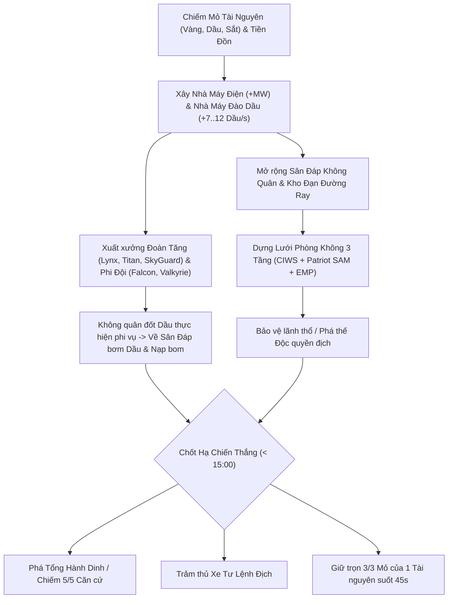
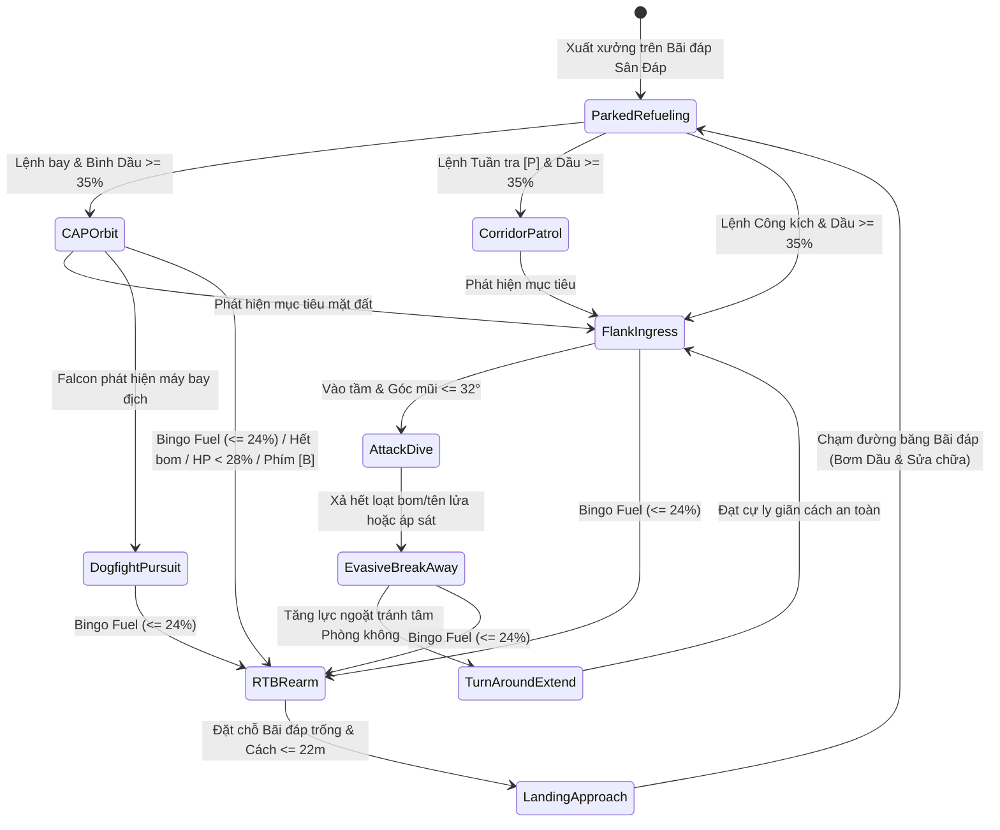

# TÀI LIỆU THIẾT KẾ GAME (GDD) — IRON SKY: TƯ LỆNH CHIẾN THUẬT & HẬU CẦN 3D

**Phiên bản thiết kế:** v2.0 (Bản nâng cấp Hậu cần Không quân Sân đáp, Đào Dầu, Lưới Điện & Đường Ray Phòng Không)  
**Thể loại:** Chiến thuật Thời gian thực 3D (3D Tactical & Logistics RTS)  
**Nền tảng:** Trình duyệt web (PC + điện thoại) — TypeScript + Three.js. *(Tài liệu này viết cho bản Unity thử nghiệm cũ; từ 03/11/2026 game chuyển sang 3D trên web. Thiết kế vẫn dùng được, chi tiết riêng của Unity thì bỏ qua.)*  
**Thời lượng chuẩn mỗi ván:** Tối đa **15 phút** (`900 giây`)

---

## 1. Tầm Nhìn Thiết Kế & 4 Trụ Cột Cốt Lõi (Design Pillars)

1. **Tư Lệnh Trực Tiếp Trên Chiến Trường (*Direct Commander Presence*):**
   Người chơi không phải một thực thể vô hình trên cao mà trực tiếp hóa thân vào **Xe Tư Lệnh Chiến Thuật**. Đưa Tư lệnh ra tiền tuyến giúp tăng tốc chiếm cứ điểm (`x2.2`), mở rộng vùng đặt công trình (`26m`) và truyền hào quang chiến đấu (`+18%` tốc bắn), nhưng nếu chủ quan để Xe Tư Lệnh bị phục kích hạ gục, trận đấu kết thúc ngay lập tức.
2. **Không Quân Khí Động Học Thông Minh & Giới Hạn Nhiên Liệu Thật (*Smart Aerodynamics & Physical Fuel*):**
   Máy bay không đứng yên bắn như trực thăng giả lập mà bay theo quỹ đạo vật lý mượt mà (vòng lượn tiếp tuyến CAP, lượn sườn né phòng không, bổ nhào rải bom, bật tăng lực thoát ly). Đồng thời, sức mạnh bầu trời bị neo chặt vào mặt đất thông qua **Sân Đáp Không Quân** và **bình Dầu trên thân máy bay** (`>= 35%` mới được cất cánh, trừ dần từng giây khi bay).
3. **Hậu Cần Trực Quan Tạo Chiều Sâu Phản Khắc Chế (*Visible Physical Logistics*):**
   Mọi hệ thống hậu cần đều hiển thị vật lý trên không gian 3D: **dây cáp điện võng 3D** nối từ Nhà máy Điện qua Trạm truyền tải, và **đường ray thép đôi có Xe Goòng 3D** chở thùng đạn chạy từ Kho đạn tới từng Tháp Phòng Không. Đối phương nhìn thấy cấu trúc hậu cần và có thể đánh chặt mắt xích yếu nhất (bắn sập 1 cột điện hoặc 1 kho đạn để làm tê liệt cả cụm Patriot SAM / EMP!).
4. **Nhịp Độ 15 Phút Đa Mục Tiêu (*High-Stakes 15-Minute Victory Triangle*):**
   Ba con đường chiến thắng (*Công phá Căn cứ*, *Trảm thủ Tư lệnh*, *Độc quyền 3/3 Mỏ tài nguyên trong 45s*) buộc người chơi liên tục đọc thế trận, không thể "bo nhà" thụ động.

---

## 2. Vòng Lặp Gameplay Cốt Lõi (Core Gameplay Loop)



---

## 3. Thiết Kế Bản Đồ 3D & Địa Hình Chiến Thuật (`Level Design`)

### 3.1. Cấu trúc Hình học Đối xứng Tâm 180°
- Kích thước mặt phẳng chiến đấu: `[-86, +86]` theo cả trục `X` và `Z` (`172m x 172m` vùng hoạt động trong khung nền `184m x 184m`).
- **Dòng sông chéo chiến lược (`x + z = 0`, bề rộng `|x + z| < 9.5m`):** Chia đôi bản đồ thành bờ Tây Nam (Liên Minh Lam) và bờ Đông Bắc (Tập Đoàn Đỏ).
- **7 Cây cầu vượt sông** phân bố dọc theo trục `v = z - x`:
  1. Cầu Thượng lưu Tây Bắc `(-62, 62)` — gắn liền *Mỏ Vàng Cao Nguyên*.
  2. Cầu Tiền đồn Tây Bắc `(-34, 34)` — gắn liền *Căn Cứ Tiền Đồn Tây Bắc*.
  3. Cầu Sắt Trung tâm Bắc `(-16, 16)` — gắn liền *Lò Luyện Sắt Cầu Trung Tâm*.
  4. **Đại Cầu Thành Cổ Alpha `(0, 0)`** — trục giao tranh chính giữa bản đồ.
  5. Cầu Trung tâm Nam `(16, -16)` — lối tạt sườn nhanh cho Thiết giáp Lynx.
  6. Cầu Tiền đồn Đông Nam `(34, -34)` — gắn liền *Căn Cứ Tiền Đồn Đông Nam*.
  7. Cầu Hạ lưu Đông Nam `(62, -62)` — gắn liền *Giàn Khoan Dầu Thung Lũng*.

### 3.2. Ý đồ Chiến thuật của Địa hình 3D
- **Thiết giáp mặt đất (`Tank`)** bắt buộc phải định tuyến qua 1 trong 7 cây cầu và vòng qua 8 cụm núi đá chắn (`RockRidge`), tạo nên các nút thắt cổ chai lý tưởng để phục kích pháo kích `[R]` hoặc dàn Tăng Titan.
- **Không quân (`Falcon`, `Valkyrie`)** bay ở cao độ `12.5m – 15.0m` vượt thẳng qua sông và núi đá, nhưng lại bị giới hạn bởi **bán kính nhiên liệu Dầu** và **ô hỏa lực 38.5m của Tên lửa Patriot SAM / Tháp EMP**.

---

## 4. Thiết Kế Cơ Chế Không Quân Thông Minh & Hậu Cần Sân Đáp

### 4.1. Máy Trạng Thái Khí Động Học 10 Pha (`FlightPhase`)



### 4.2. Các Thuật toán Quỹ đạo Thông minh (`AircraftFlightController.cs`)
1. **Trường Vector Tiếp tuyến Lyapunov (Quỹ đạo vòng tròn `CAPOrbit`):**
   Khi tuần tiễu quanh tâm $\mathbf{c}$ với bán kính $R$ và khoảng cách hiện tại $r = \|\mathbf{p} - \mathbf{c}\|$, hướng bay mong muốn được tổng hợp mượt giữa vector hướng tâm $\hat{\mathbf{u}}_{rad}$ và vector tiếp tuyến $\hat{\mathbf{u}}_{tan}$:
   $$\mathbf{v}_{des} = \text{normalize}\!\left(\hat{\mathbf{u}}_{tan} - k \cdot \frac{r - R}{R} \cdot \hat{\mathbf{u}}_{rad}\right)$$
   Nhờ đó máy bay từ xa bay thẳng tới tiếp tuyến vòng tròn rồi tự động ôm cua mượt mà vào quỹ đạo tròn mà không bao giờ giật cục.
2. **Cơ động Vòng sườn & Thoát ly Né Phòng Không (`AAThreatCentroid`):**
   Trước khi bổ nhào (`FlankIngress`) và ngay sau khi cắt bom (`EvasiveBreakAway`), máy bay truy vấn tâm trọng số của toàn bộ xe SkyGuard + các Tháp `CIWS` / `Patriot SAM` / `EMP` **đang có điện và còn đạn** của địch trong bán kính `44m`, từ đó chọn vector ngoặt vuông góc rời xa vùng tập trung phòng không dày đặc nhất.
3. **Ràng buộc Nhiên liệu Dầu & Rủi ro Chiến thuật:**
   - **Khóa xuất kích `< 35%`:** Nếu quốc gia cạn sạch `0` Dầu, máy bay nằm trên Sân Đáp không thể bơm đủ `35%` bình nhiên liệu và bị ghim tại sân bay -> buộc Tư lệnh phải bảo vệ Giàn Dầu hoặc xây **Nhà Máy Đào Dầu**.
   - **Tác chiến chống Sân Đáp (*Counter-Airbase Strike*):** Nếu phi đội địch đang bay xa mà bạn dùng Cường kích hoặc Tăng đột kích phá hủy Sân Đáp duy nhất của địch, toàn bộ máy bay địch khi cạn `0%` Dầu sẽ không còn nơi hạ cánh và **rơi hàng loạt (`ForceFuelCrash`)**!

---

## 5. Thiết Kế Hệ Sinh Thái Hậu Cần: Lưới Điện & Đường Ray Tiếp Đạn

### 5.1. Đồ thị Mạng Lưới Điện (`Electric Power Grid`)
- **Mô hình kết nối không gian (Spatial BFS):**
  - **Nguồn gốc (Generator Roots):** Tổng Hành Dinh (`+40 MW`, `34m`) và mọi `PowerPlant` (`+45 MW`, `30m`).
  - **Nút trung chuyển (Relays):** Các `PowerPylon` (`+8 MW`, `30m`) nối chuỗi BFS mở rộng vùng phủ điện ra các mỏ xa và tiền đồn.
  - **Tải tiêu thụ (Consumers):** Kết nối tới nút nguồn/trung chuyển gần nhất trong bán kính phủ sóng, hiển thị bằng dây cáp điện võng parabol 3D.
- **Công thức Hiệu suất Lưới điện (`GridEfficiency`):**
  $$\text{GridEfficiency} = \begin{cases} 1.0 & \text{nếu } P_{consumed} \le P_{generated} \\ \text{clamp}_{[0, 1]}\!\left(\dfrac{P_{generated}}{P_{consumed}}\right) & \text{nếu } P_{consumed} > P_{generated} \end{cases}$$
- **Hệ quả Chiến thuật khi Đứt điện hoặc Quá tải:**
  - `AA_SAM` (Patriot `-14 MW`) và `AA_EMP` (SkyShield `-16 MW`) có cờ `requiresStrictPower = true`: **tê liệt hoàn toàn** nếu đứt cáp truyền tải hoặc lưới điện sụt dưới `45%`.
  - `OilExtractor` mất điện tụt sản lượng từ `100%` xuống chỉ còn `28%`; `Airfield` bơm dầu & sửa máy bay chậm còn `40%`; `AmmoDepot` chế đạn chậm và Xe Goòng chạy chậm hơn.

### 5.2. Đồ thị Đường Ray Thép & Xe Goòng Tiếp Đạn Phòng Không (`Ammo Railway`)
- **Mô hình nối ray 2 tầng (Two-Tier Railway BFS):**
  - Tầng 1: Từ `AmmoDepot` nối trực tiếp tới mọi Tháp Phòng Không trong bán kính **`<= 46m`**.
  - Tầng 2: Từ một Tháp Phòng Không đã có ray có thể **nối chuỗi liên hoàn** sang Tháp Phòng Không kế tiếp trong bán kính **`<= 26m`**, đồng thời lưu bảng cha `m_RailParentMap` để tìm đường đi ngắn nhất trên ray.
- **Cơ chế Điều phối Xe Goòng Vật lý (`AmmoRailCart`):**
  - Mỗi `1.15s`, `AmmoDepot` (nếu kho có `>= 4` đạn) tìm tháp AA kết nối đang thiếu đạn nhất theo lượng thiếu thực tế:
    $$\text{Missing} = \text{MaxMagazine} - (\text{CurrentLocalAmmo} + \text{IncomingCartAmmo})$$
  - Kho xuất 1 chiếc **Xe Goòng 3D** chở thùng đạn phát sáng vàng (`4..16` viên) lăn bánh dọc theo các đoạn đường ray qua từng nút trung gian tới tận tháp AA, nạp đạn, ẩn thùng hàng và chạy ngược về kho!

### 5.3. Thiết kế Phối hợp Phòng Không 3 Tầng (`Layered Air Defense`)
| Tầng phòng thủ | Tổ hợp | Tầm bắn | Cơ chế phối hợp tối ưu |
|---|---|---|---|
| **Tầng Ngoài (38.5m)** | `Tên Lửa Patriot SAM` | `38.5m` | Bắn phủ đầu sát thương cực lớn (`112 ST`) buộc Cường kích Valkyrie địch mất máu nặng ngay từ pha tiếp cận. |
| **Tầng Giữa (30.0m)** | `Tháp Xung EMP SkyShield` | `30.0m` | Làm chậm cả biên đội máy bay địch `-35%` tốc bay & tốc cua trong `3.8s`, khiến chúng lơ lửng lâu trong vùng chết. |
| **Tầng Trong (22.5m)** | `Pháo CIWS Vulcan` | `22.5m` | Tận dụng thời gian máy bay địch bị EMP làm chậm để xả mưa đạn 6 nòng (`0.24s/viên`) kết liễu mục tiêu. |
| **Cơ Động (26.5m)** | `Xe SkyGuard AA Tank` | `26.5m` | Đi theo bảo vệ đoàn Tăng chủ lực Titan khi tấn công sang bên kia sông ngoài tầm phủ đường ray nhà. |

---

## 6. Ma Trận Khắc Chế Chiến Thuật (Counter Matrix)

| Đơn vị / Công trình | Khắc chế mạnh (Strong Against) | Bị khắc chế bởi (Countered By) |
|---|---|---|
| **Thiết Giáp Lynx (`ReconTank`)** | Chiếm mỏ trống, đánh lén Cột điện (`PowerPylon`), Kho đạn (`AmmoDepot`) | Tăng Titan (`MBT`), Tiêm kích Falcon, Pháo tự vệ Tiền đồn |
| **Tăng Chủ Lực Titan (`MBT`)** | Lynx, SkyGuard, toàn bộ Tháp Phòng Không, Công trình & HQ địch | **Cường kích Valkyrie** (không bắn trả được trên không!), Pháo kích `[R]` |
| **Xe Phòng Không SkyGuard** | Tiêm kích Falcon, Cường kích Valkyrie | Tăng Chủ Lực Titan, Xe Tư Lệnh |
| **Tiêm Kích Falcon (`StrikeFighter`)** | **Cường kích Valkyrie** (không chiến bám đuôi), Lynx lẻ loi | Tên lửa Patriot SAM, Tháp EMP + CIWS, Xe SkyGuard |
| **Cường Kích Valkyrie (`HeavyBomber`)** | Cụm Tăng Titan, Nhà máy Điện, Kho đạn Đường ray, Tổng Hành Dinh | Tiêm kích Falcon, Tổ hợp Patriot SAM + EMP |
| **Cụm Phòng Không (SAM + EMP + CIWS)** | Mọi đợt không kích của Falcon & Valkyrie | Tăng Chủ Lực Titan, Pháo kích `[R]`, hoặc **bị đánh sập Nhà máy Điện / Kho đạn Đường ray** |

---

## 7. Nhịp Độ Trận Đấu 15 Phút & Công Thức Điểm Chiến Thuật

### 7.1. Đường cong Nhịp độ 3 Giai đoạn
- **Giai đoạn 1 — Khai cuộc & Dựng Hậu cần (`15:00 → 11:00`):**
  Tư lệnh cùng 2 xe Lynx tỏa ra chiếm các Mỏ Vàng/Dầu gần nhà; xây **Nhà Máy Điện** đầu tiên và đặt **Nhà Máy Đào Dầu** sát vỉa Dầu (`+12 Dầu/s`) để chuẩn bị nguồn nhiên liệu dồi dào.
- **Giai đoạn 2 — Tranh chấp Cầu, Tiền đồn & Không chiến (`11:00 → 04:00`):**
  Giao tranh ác liệt quanh *Pháo Đài Alpha `(0,0)`* và hai cầu biên để giành mỏ thứ 3 kích hoạt đếm ngược **45 giây Độc quyền Tài nguyên**. Hai bên mở rộng đường ray Phòng không 3 tầng và dùng Cường kích ném bom cắt mạch điện/đường ray của nhau.
- **Giai đoạn 3 — Tổng Công Kích Định Đoạt (`04:00 → 00:00`):**
  Cảnh báo vang lên ở mốc `03:00` và `01:00`. Đột kích hiệp đồng Tăng Titan + SkyGuard + Không quân + Pháo kích `[R]` nhắm thẳng vào Xe Tư Lệnh hoặc Tổng Hành Dinh đối phương.

### 7.2. Công thức Phân định Thắng bại khi hết 15:00 (`ComputeTacticalScore`)
$$\text{TacticalScore} = 300 \times N_{\text{Căn cứ}} + 150 \times N_{\text{Mỏ}} + 65 \times N_{\text{Công trình}} + 45 \times N_{\text{Tiêu diệt}} + \left\lfloor 250 \cdot \frac{HP_{\text{Tư lệnh}}}{MaxHP} \right\rfloor + \left\lfloor 250 \cdot \frac{HP_{\text{HQ}}}{MaxHP} \right\rfloor$$

---

## 8. Thiết Kế Bố Cục HUD 3D (`1920 x 1080` — Không Chồng Lấn)

```text
+--------------------------------------------------------------------------------------------------+
| [VÀNG 12..188] [DẦU 194..380] [SẮT 386..562] [ĐIỆN & RAY 568..806] | [15:00 & TỔNG QUAN 816..1302] | [5 NÚT TIỆN ÍCH 1320..1908] |
+--------------------------------------------------------------------------------------------------+
|                          [BANNER ĐẾM NGƯỢC ĐỘC QUYỀN 3/3 MỎ — 45.0s (Ẩn khi bình thường)]        |
|                          [THANH THÔNG BÁO CHIẾN THUẬT & PREVIEW NỐI ĐIỆN / ĐƯỜNG RAY]            |
|                                                                                                  |
|                                     KHÔNG GIAN CHIẾN TRƯỜNG 3D                                 |
|                     (Cáp điện võng 3D • Đường ray & Xe Goòng • Đường bay dự đoán)                |
|                                                                                                  |
+--------------------+---------------------------------------------+-------------------------------+
|  RADAR CHIẾN THUẬT |   BẢNG CHỈ HUY & THÔNG SỐ (X: 274..1106)    | NHÀ MÁY 2 TAB (X: 1118..1906) |
|    (X: 14..262)    | • Máu, Bình Dầu máy bay (%), Điện & Đạn Ray | [QUÂN ĐỘI F3] | [XÂY DỰNG F4] |
|  Click: Đưa Camera | • Học thuyết: Cân Bằng | Xung Kích | Né AA  | • F3: 5 Thẻ Tank & Không quân |
|  Chuột phải: Lệnh  | • Tuyệt kỹ Tư lệnh: [Q] Radar [E] Sửa [R] Pháo| • F4: Lưới 4x2 (8 Công trình) |
+--------------------+---------------------------------------------+-------------------------------+
```

---

## 9. Định Hướng Mở Rộng Cho Các Phiên Tiếp Theo (Future Roadmap)

Các tính năng dưới đây tương thích trực tiếp với kiến trúc `TacticalBuilding`, `LogisticsNetworkManager` và `RTSTypes` hiện tại nếu người dùng muốn nâng cấp tiếp:
1. **Pháo Binh Đường Ray Hạng Nặng (`RailArtillery`):** Công trình hoặc toa pháo chạy trên chính hệ thống Đường ray của `AmmoDepot`, tiêu thụ lượng lớn đạn ray & điện MW để pháo kích tầm siêu xa.
2. **Sương Mù Chiến Tranh (`Fog of War` 3D) & Trạm Radar Cảnh Giới:** Tận dụng chỉ số `visionRange` đã khai báo sẵn trên toàn bộ `UnitSpec` để ẩn quân địch ngoài tầm nhìn và cho phép xây Đài Radar mở sáng bản đồ.
3. **Nâng Cấp Cấp Độ Công Nghệ (`Tech Tiers` tại Tổng Hành Dinh):** Mở khóa Giáp phản ứng nổ cho Titan MBT, Bình dầu phụ tầm xa (`+35% MaxFuel`) cho Không quân, và Lò phản ứng nhiệt hạch (`+100 MW`).
4. **Chế Độ Chiến Dịch Nhiều Màn (`Campaign Missions`):** Chuỗi 3–5 bản đồ với địa hình sông/đảo/hẻm núi khác nhau và mục tiêu nhiệm vụ chuyên biệt.
